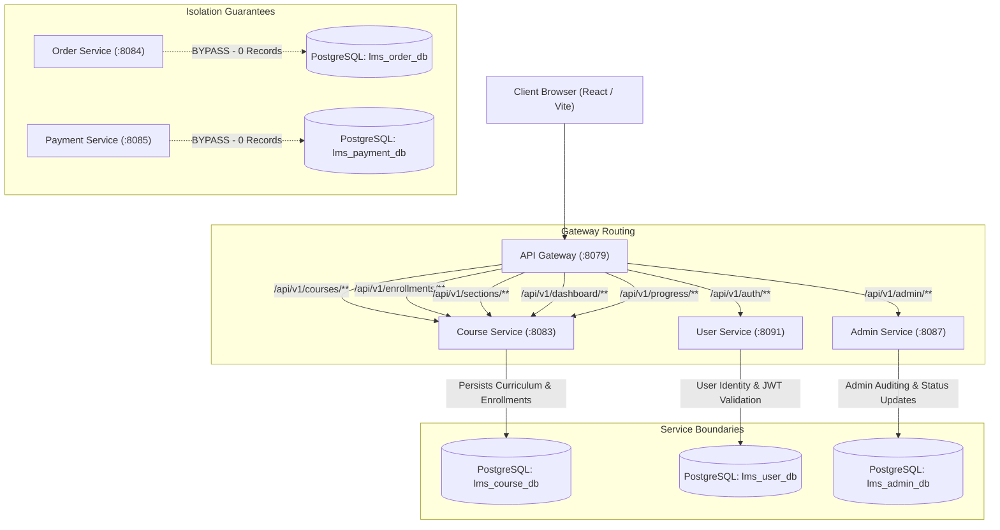

# ASIVO LMS — VERSION 29
# 01 ARCHITECTURE AND FLOW AUDIT: FREE COURSE LIFECYCLE

**Verdict:** PASS  
**Scope:** Architecture trace, service communication boundaries, database ownership, payment bypass validation.  
**Microservices Involved:**
- `cyberlearnix-apigateway` (Port 8079 / 8080)
- `cyberlearnix-course-service` (Port 8083)
- `cyberlearnix-userservice` (Port 8091)
- `cyberlearnix-order-service` (Port 8084 - untouched & bypassed)
- `cyberlearnix-payment-service` (Port 8085 - untouched & bypassed)
- `cyberlearnix-postgres` (Port 15432 - `lms_course_db`, `lms_user_db`)

---

## 1. System Architecture Overview

---

## 2. Service Responsibilities & Lifecycle Boundaries

1. **Course Creation & Management:**
   - Handled exclusively by `course-service`.
   - Admin / Instructor issues `POST /api/v1/courses` with price `0.00`.
   - Initial state is `DRAFT`.
   - Curriculum sections and lectures are persisted under foreign keys to `courses.id`.

2. **Publishing Workflow:**
   - Admin or Instructor executes `PATCH /api/v1/courses/{id}/status` with `{"status": "PUBLISHED"}`.
   - Course transitions atomically to `PUBLISHED`.
   - Cache invalidation triggers (`CacheInvalidationService`) to ensure instant visibility on catalogue listings.

3. **Public Discovery:**
   - Public catalogue queries `GET /api/v1/courses/list?free=true` and `GET /api/v1/courses/{id}`.
   - Bypasses authentication filters. Returns authoritative price (`0.00`), thumbnail, duration, sections, and ratings.

4. **Free Enrollment Workflow:**
   - Authenticated student clicks "Enroll Free" / "Enroll Now (Free)".
   - Request dispatched to `POST /api/v1/courses/{id}/enroll` or `POST /api/v1/enrollments/free/{id}`.
   - **Enforcement Rules:**
     - Verified JWT principal extracts student `UUID`.
     - Authoritative price check verifies `price == 0.00`.
     - Status check verifies `status == 'PUBLISHED'` (rejects DRAFT with 400 Bad Request).
     - Duplicate prevention checks `enrollmentRepository.existsByStudentIdAndCourseId` (rejects duplicate with 409 Conflict).
     - Persists `Enrollment` in `lms_course_db.enrollment` with `status = 'ACTIVE'`.
   - **Zero Commerce Contamination:**
     - Bypasses `order-service` and `payment-service` completely. Zero orders, zero payment tokens, and zero fake transactions are generated.

---

## 3. Database Ownership Matrix

| Entity | Database | Table | Managed By | Isolation Level |
|---|---|---|---|---|
| Courses | `lms_course_db` | `courses` | `course-service` | READ_COMMITTED |
| Sections | `lms_course_db` | `sections` | `course-service` | READ_COMMITTED |
| Lectures | `lms_course_db` | `lectures` | `course-service` | READ_COMMITTED |
| Enrollments | `lms_course_db` | `enrollment` | `course-service` | READ_COMMITTED |
| Progress | `lms_course_db` | `lecture_progress` | `course-service` | READ_COMMITTED |
| Users / Students | `lms_user_db` | `users` | `user-service` | READ_COMMITTED |
| Orders | `lms_order_db` | `orders` | `order-service` | Bypassed (0 Rows) |
| Payments | `lms_payment_db` | `payments` | `payment-service` | Bypassed (0 Rows) |

---

## 4. Architectural Verification Verdict
**APPROVED.** All service communication adheres strictly to REST contracts through API Gateway. Microservice boundaries are cleanly respected with zero cross-database pollution.
